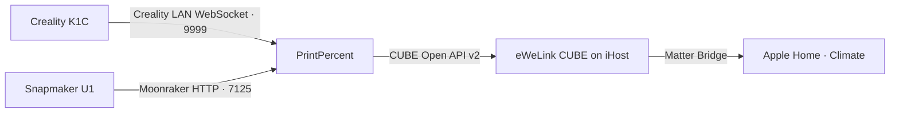

# PrintPercent

Monitor Klipper-based 3D printer progress in Apple Home via SONOFF iHost.

PrintPercent reads print progress over your local network and publishes one read-only sensor per printer to eWeLink CUBE. It can run as a Docker add-on directly on a SONOFF iHost.

## How it works



Apple Home displays progress through a read-only humidity sensor. A reading of **65% humidity** means the print is **65% complete**. The bridge waits 10 seconds between polling cycles and marks a registered sensor offline if the printer stops providing usable data.

## Printer compatibility

| Printer | Local interface | Requirements |
| --- | --- | --- |
| Creality K1C | Creality WebSocket on TCP 9999 | Firmware must expose the LAN WebSocket and report `deviceState` and `printProgress`. |
| Snapmaker U1 | Moonraker on TCP 7125 | Moonraker must be reachable from iHost. Supply an API key if required. |

Both printers are Klipper-based. The K1C adapter uses Creality's LAN protocol, and the U1 adapter queries the standard Moonraker printer objects `print_stats`, `display_status`, and `virtual_sdcard`. The current configuration exposes two model-specific entries. Additional Klipper models need their own configuration support. See the [Creality Klipper source](https://github.com/CrealityOfficial/K1_Series_Klipper), [Creality LAN protocol reference](https://github.com/heydemoura/creality-orca-integration/blob/main/docs/protocol.md), [Snapmaker Moonraker fork](https://github.com/Snapmaker/u1-moonraker), and [Moonraker printer objects](https://moonraker.readthedocs.io/en/latest/printer_objects/).

The adapters have been checked against simulated responses. The ARMv7 image builds locally. End-to-end testing on real printers and export of the virtual sensors through iHost Matter Bridge are pending.

## Requirements

- SONOFF iHost running eWeLink CUBE with Open API v2 and Matter Bridge enabled.
- Both printers reachable on the same local network as the bridge.
- Docker with Buildx and a container registry account to publish your iHost image. Node.js 22 or newer is sufficient for running the bridge directly on a computer.

## Get an iHost access token

Sign in to the iHost web console. Replace the example IP and run the first request. Approve it in the iHost web console, then repeat the request to obtain the token. See the [eWeLink Open API v2 guide](https://ewelink.cc/ewelink-cube/introduce-open-api/document/).

```powershell
$tokenUrl = 'http://192.168.1.10/open-api/v2/rest/bridge/access_token?app_name=PrintPercent'
Invoke-RestMethod $tokenUrl -ContentType 'application/json'
# Run after approving the request in the iHost web console.
(Invoke-RestMethod $tokenUrl -ContentType 'application/json').data.token
```

## Run on SONOFF iHost

1. Clone this repository and build an ARMv7 image. Replace `YOUR_DOCKERHUB_USER` with your Docker Hub username.

   ```sh
   git clone https://github.com/MCKanpolat/printpercent.git
   cd printpercent
   docker login
   docker buildx build --platform linux/arm/v7 --provenance=false --sbom=false --tag YOUR_DOCKERHUB_USER/printpercent:latest --push .
   ```

2. In the iHost web console, go to **Docker → Add add-on**, add `YOUR_DOCKERHUB_USER/printpercent`, and install it. If iHost asks for a TF card, follow the [eWeLink add-on setup guide](https://ewelink.cc/ewelink-cube/add-on/).
3. In the **Run** dialog, select **Host** networking and set the following environment variables. Replace the example addresses with your own.

   | Variable | Example or purpose |
   | --- | --- |
   | `IHOST_URL` | `http://192.168.1.10` |
   | `IHOST_TOKEN` | Token from the iHost web console |
   | `SERVICE_URL` | `http://192.168.1.10:8787/ihost`, using the iHost LAN address |
   | `K1C_WS_URL` | `ws://192.168.1.30:9999/` |
   | `U1_URL` | `http://192.168.1.31:7125` |
   | `U1_API_KEY` | Optional Moonraker API key |

4. Start the add-on and check its logs for progress readings. Each sensor appears in iHost after its first successful printer reading. The current device names are **K1C Baskı İlerlemesi** and **U1 Baskı İlerlemesi**.

## Add the sensors to Apple Home

Open **Matter Bridge** in iHost and check whether the two sensors appear in the device list. Share them through your iHost bridge and look for the readings under **Climate** in Apple Home. During a print, compare the displayed percentage with the printer's own display. See the [eWeLink Apple Home guide](https://ewelink.org/docs/help-guide/apple-home-integration).

## Run on a computer

Copy [`.env.example`](.env.example) to `.env` and fill in the same variables. Set `SERVICE_URL` to the computer's LAN address on port 8787, which iHost needs to reach. The local `.env` file is ignored by Git.

```sh
node --env-file=.env bridge.mjs
```

With Docker Compose, use `docker compose up -d --build` and view the logs with `docker compose logs -f`.

## Troubleshooting

- **K1C WebSocket timeout:** Check whether the printer firmware exposes TCP 9999 and reports both required fields on your LAN.
- **Moonraker authentication or connection error:** Check the U1 address, port 7125, and API key. On the LAN, `http://U1_IP:7125/server/info` can help confirm reachability.
- **iHost authentication error:** Check the access token and whether `IHOST_URL` points to the same iHost that issued it.
- **Sensors appear in CUBE but not in Matter Bridge:** Record your CUBE firmware version and the sensor category shown in iHost. Export of third-party virtual sensors depends on bridge support.

## Contributing

Open an issue or pull request for a reproducible bug or printer compatibility improvement. Include the printer model, firmware version, CUBE version, and relevant log lines. Remove API keys and access tokens from shared output.
