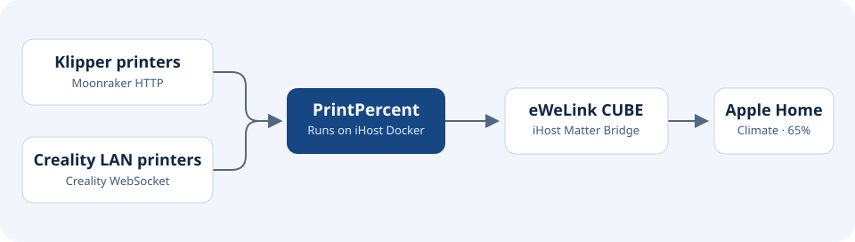

# PrintPercent

Monitor Klipper-based 3D printer progress in Apple Home via SONOFF iHost.

PrintPercent reads print progress over your local network and publishes one read-only sensor per printer to eWeLink CUBE. It can run as a Docker add-on directly on a SONOFF iHost.

## How it works



Apple Home displays progress through a read-only humidity sensor. A reading of **65% humidity** means the print is **65% complete**. The bridge waits 10 seconds between polling cycles and marks a registered sensor offline if the printer stops providing usable data.

## Printer compatibility

PrintPercent supports any Klipper printer that exposes the required [Moonraker printer objects](https://moonraker.readthedocs.io/en/latest/printer_objects/) over HTTP. Add one configuration entry per printer. Moonraker must return `print_stats.state` and either `display_status.progress` or `virtual_sdcard.progress` during a print.

| Example printer | Adapter | How to connect |
| --- | --- | --- |
| Any Klipper printer with Moonraker | `moonraker` | Use the LAN address of its Moonraker host, typically `http://PRINTER_IP:7125`. |
| [Voron 2.4 or Trident](https://docs.vorondesign.com/build/software/) | `moonraker` | Use the IP of the Raspberry Pi or other Klipper host running Moonraker. |
| [Rat Rig V-Core 4 with RatOS](https://os.ratrig.com/docs/introduction/) | `moonraker` | Use the IP of the RatOS host and its Moonraker port. |
| [Elegoo Neptune 4 or 4 Pro](https://wiki.elegoo.com/en/neptune/neptune-4-4pro-shutdown-due-to-webhooks-request) | `moonraker` | Find the printer IP used by Fluidd and check which LAN URL serves the Moonraker API on your firmware. |
| [Snapmaker U1](https://github.com/Snapmaker/u1-moonraker) | `moonraker` | Use `http://PRINTER_IP:7125`. Set a Moonraker API key if required. |
| [Creality K1C with Creality LAN](https://github.com/heydemoura/creality-orca-integration/blob/main/docs/protocol.md) | `creality` | Use `ws://PRINTER_IP:9999/` if the firmware exposes `deviceState` and `printProgress` over WebSocket. If the printer exposes standard Moonraker, use the Moonraker adapter. |

The model entries are setup examples. Adapter behavior was checked with simulated API responses. Real-printer testing and export of virtual sensors through iHost Matter Bridge are pending.

## Requirements

- SONOFF iHost running eWeLink CUBE with Open API v2 and Matter Bridge enabled.
- At least one compatible printer reachable from the bridge on the local network.
- Node.js 22 or newer for running the bridge directly on a computer.

## Get an iHost access token

Sign in to the iHost web console. Replace the example IP and run the first request. Approve it in the iHost web console, then repeat the request to obtain the token. See the [eWeLink Open API v2 guide](https://ewelink.cc/ewelink-cube/introduce-open-api/document/).

```powershell
$tokenUrl = 'http://192.168.1.10/open-api/v2/rest/bridge/access_token?app_name=PrintPercent'
Invoke-RestMethod $tokenUrl -ContentType 'application/json'
# Run after approving the request in the iHost web console.
(Invoke-RestMethod $tokenUrl -ContentType 'application/json').data.token
```

## Run on SONOFF iHost

1. Go to **Docker → Add add-on** in the iHost web console and install [`mckanpolat/printpercent`](https://hub.docker.com/r/mckanpolat/printpercent). iHost pulls the public ARMv7 image tagged `latest`. If iHost asks for a TF card, follow the [eWeLink add-on setup guide](https://ewelink.cc/ewelink-cube/add-on/).
2. In the **Run** dialog, select **Host** networking and set the following environment variables. Replace the example addresses with your own.

   | Variable | Example or purpose |
   | --- | --- |
   | `IHOST_URL` | `http://192.168.1.10` |
   | `IHOST_TOKEN` | Token from the iHost web console |
   | `SERVICE_URL` | `http://192.168.1.10:8787/ihost`, using the iHost LAN address |
   | `PRINTERS_JSON` | JSON array of printer connections |

3. Start the add-on and check its logs for progress readings. Each sensor appears in iHost after its first successful printer reading.

## Configure printers

Paste the JSON array as one line into the iHost environment variable field. In a local `.env` file, wrap the JSON in single quotes as shown in [`.env.example`](.env.example).

```json
[
  {"id":"voron-24","name":"Voron 2.4 Print Progress","url":"http://192.168.1.31:7125","manufacturer":"Voron Design","model":"2.4"},
  {"id":"v-core-4","name":"V-Core 4 Print Progress","url":"http://192.168.1.32:7125"},
  {"id":"neptune-4-pro","name":"Neptune 4 Pro Print Progress","url":"http://192.168.1.33:7125"},
  {"id":"u1","name":"U1 Print Progress","url":"http://192.168.1.34:7125","apiKeyEnv":"U1_API_KEY"},
  {"id":"k1c","name":"K1C Print Progress","type":"creality","url":"ws://192.168.1.35:9999/"}
]
```

- `id` must be unique and use lowercase letters, digits, or hyphens. Keep it stable to retain the same registered sensor.
- `name` is the sensor name at registration. `manufacturer` and `model` are optional.
- `type` defaults to `moonraker`. Use `creality` for the vendor WebSocket protocol.
- `apiKeyEnv` is optional. When set, create the named environment variable with the Moonraker API key. Remove `apiKeyEnv` from the example if your Moonraker server allows access without a key.

Existing deployments can keep `K1C_WS_URL`, `U1_URL`, and optional `U1_API_KEY`. When migrating to `PRINTERS_JSON`, reuse the IDs `k1c` and `u1` to retain their existing iHost sensors.

## Add the sensors to Apple Home

Open **Matter Bridge** in iHost and check whether the printer sensors appear in the device list. Share them through your iHost bridge and look for the readings under **Climate** in Apple Home. During a print, compare the displayed percentage with the printer's own display. See the [eWeLink Apple Home guide](https://ewelink.org/docs/help-guide/apple-home-integration).

## Run on a computer

Copy [`.env.example`](.env.example) to `.env` and fill in the same variables. Set `SERVICE_URL` to the computer's LAN address on port 8787, which iHost needs to reach. The local `.env` file is ignored by Git.

```sh
node --env-file=.env bridge.mjs
```

With Docker Compose, use `docker compose up -d --build` and view the logs with `docker compose logs -f`.

## Troubleshooting

- **K1C WebSocket timeout:** Check whether the printer firmware exposes TCP 9999 and reports both required fields on your LAN.
- **Moonraker authentication or connection error:** Check the configured URL and API key. On the LAN, `http://PRINTER_IP:7125/server/info` can help confirm reachability.
- **iHost authentication error:** Check the access token and whether `IHOST_URL` points to the same iHost that issued it.
- **Sensors appear in CUBE but not in Matter Bridge:** Record your CUBE firmware version and the sensor category shown in iHost. Export of third-party virtual sensors depends on bridge support.

## Contributing

Open an issue or pull request for a reproducible bug or printer compatibility improvement. Include the printer model, firmware version, CUBE version, and relevant log lines. Remove API keys and access tokens from shared output.

The entry point is `bridge.mjs`. Configuration, printer adapters, the CUBE client, and HTTP requests live in `src/`. The architecture graphic is in `docs/`.

## Publish the Docker image

Create a public Docker Hub repository named `printpercent`. In this GitHub repository's **Settings → Secrets and variables → Actions**, set the `DOCKERHUB_USERNAME` repository variable and the `DOCKERHUB_TOKEN` repository secret. The token needs permission to push to the Docker Hub repository.

Run **Actions → Publish Docker image → Run workflow** on `main`. The workflow builds the `linux/arm/v7` image, pushes `mckanpolat/printpercent:latest`, and reports the full image name.
